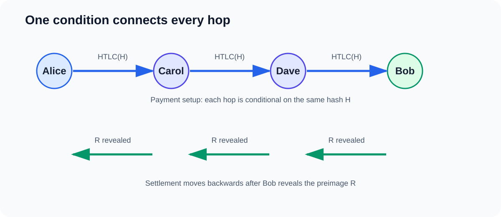
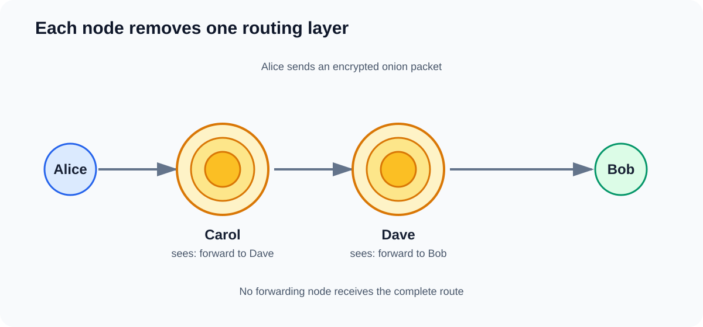
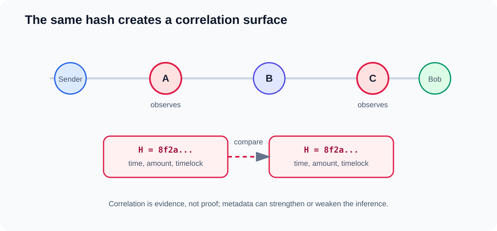

# Can Lightning Nodes Track Your Payments? A Look Inside HTLCs and Onion Routing

*Lightning payments don't appear individually on Bitcoin's blockchain, and onion routing hides much of the payment path. But does that mean the nodes forwarding your payment can't recognize it?*

*AI Usage Disclosure: I wrote and researched this article myself. I used AI only to check grammar and language, not for research, structure, or content.*

One of the interesting things about the Lightning Network is how it changes the way we think about Bitcoin payments. On Bitcoin's base layer, transactions are publicly recorded, and anyone can inspect the blockchain to see how funds move between addresses. Lightning takes a different approach. Payments happen through channels, and individual transfers don't need to be published on-chain.

That gives Lightning an important privacy advantage, but it doesn't necessarily make every payment anonymous.

This article focuses on traditional HTLC-based Lightning payments. It explains a privacy property of that payment model and does not claim that every Lightning implementation or payment type exposes exactly the same information.

I recently spent some time studying privacy in Lightning, particularly how onion routing works and what intermediate nodes can learn when they forward payments. One detail caught my attention: although Lightning encrypts routing instructions, traditional payments still carry a payment hash that can be observed by multiple nodes along the route.

This creates an interesting situation. Two nodes might not know the complete payment path, yet they may still be able to recognize that they're forwarding the same payment.

To understand how this happens, we need to look at three things: onion routing, Hash Time-Locked Contracts (HTLCs), and how Lightning nodes process payments.

## How Lightning moves a payment

Suppose Alice wants to send 100,000 satoshis to Bob, but they don't have a direct Lightning channel.

Alice has a channel with Carol, Carol has one with Dave, and Dave has one with Bob. Lightning can use those existing connections to deliver the payment.

```text
Alice ─────── Carol ─────── Dave ─────── Bob
 Sender       Forwarder     Forwarder    Receiver
```

Alice doesn't need to open a new channel with Bob. Instead, Carol and Dave forward the payment through their existing channels.



But this introduces a problem. Why should Carol forward money to Dave if she can't be certain she'll receive the money from Alice? And why should Dave do the same for Bob?

Lightning needs a way to ensure that forwarding nodes can settle these payments without having to trust one another.

That's where HTLCs come in.

## HTLCs: making payments conditional

An HTLC, or Hash Time-Locked Contract, allows a payment to be claimed only when a particular condition is satisfied before a deadline.

Imagine Bob creates a secret and puts it inside a locked box. He doesn't reveal the secret, but he shares something that can be used to verify it: a cryptographic hash.

Let's call the secret `R` and its hash `H`.

```text
R = Secret preimage

H = SHA256(R)
```

Alice doesn't know `R`, but she knows `H`. She can create a conditional payment that effectively says: whoever provides the secret corresponding to `H` can claim the funds before the deadline.

Carol and Dave create corresponding conditional payments along the route.

When Bob receives the payment, he reveals the preimage. Dave can use it to settle his incoming HTLC with Carol, and Carol can use it to settle hers with Alice.

The settlement moves backwards through the route.

```text
Payment setup:

Alice ── HTLC(H) ──> Carol ── HTLC(H) ──> Dave ── HTLC(H) ──> Bob

Settlement:

Alice <──── R ────── Carol <──── R ────── Dave <──── R ────── Bob
```

Each hop uses the same payment hash, but the amounts and expiry times are adjusted to account for forwarding fees and settlement safety.

This shared condition is useful because it connects the settlement of each HTLC. A forwarding node can claim its incoming payment after satisfying its outgoing payment, without relying on the other nodes to behave honestly.

There is, however, a privacy implication that we'll return to shortly.

## What onion routing actually hides

Before discussing that privacy implication, it's important to understand the protection Lightning already provides.

Lightning uses Sphinx-based onion routing, described in [BOLT 4](https://github.com/lightning/bolts/blob/master/04-onion-routing.md).

The easiest way to understand onion routing is to imagine sending a letter through several people.

Suppose Alice wants a letter delivered to Bob through Carol and Dave. Rather than giving Carol a document listing everyone involved, Alice places the instructions inside several encrypted envelopes.

Carol opens the outer envelope and learns that she should forward the next envelope to Dave. Dave opens his envelope and learns where to send the letter next.

Neither receives the complete set of instructions.

Lightning follows a similar idea, except the envelopes are layers of encrypted routing information.

When Alice constructs a payment, she prepares an onion packet containing instructions for the nodes along the route. Each node processes its own layer and forwards the remaining packet to the next hop.

Carol knows that she received a payment from Alice and must forward it to Dave. But she isn't directly told whether Dave is the final recipient or another forwarding node.

Likewise, Dave knows his immediate neighbors, but he doesn't automatically know the entire path the payment followed.



This is a meaningful privacy guarantee. A forwarding node doesn't receive a complete map of every payment it processes.

Still, onion routing protects the routing instructions, not every piece of information associated with the HTLC.

And that's where the distinction becomes important.

## Looking inside a Lightning implementation

We can see this distinction in actual Lightning code.

Lightning Dev Kit (LDK) is an open-source implementation written in Rust. In its `rust-lightning` repository, the `UpdateAddHTLC` structure represents a message used when one Lightning peer offers an HTLC to another.

Here's a shortened excerpt from the implementation:

```rust
pub struct UpdateAddHTLC {
    pub channel_id: ChannelId,
    pub htlc_id: u64,
    pub amount_msat: u64,
    pub payment_hash: PaymentHash,
    pub cltv_expiry: u32,
    // Additional fields omitted
    pub onion_routing_packet: OnionPacket,
}
```

Source: [LDK — `lightning/src/ln/msgs.rs`](https://github.com/lightningdevkit/rust-lightning/blob/main/lightning/src/ln/msgs.rs#L738-L759)

Two fields are particularly relevant here: `payment_hash` and `onion_routing_packet`.

The `onion_routing_packet` contains the encrypted routing information that the receiving node processes to determine how to handle the payment.

The `payment_hash` identifies the condition associated with the HTLC. In a traditional multi-hop HTLC payment, that hash remains the same across the route.

In other words, the routing instructions can be protected by onion encryption while the forwarding nodes still observe a common payment hash.

This isn't an implementation mistake. It's a consequence of the way traditional HTLC-based payments coordinate settlement.

But it means that the payment hash can serve another purpose beyond settlement: it can help observers link HTLCs together.

## How two nodes can recognize the same payment

Let's extend our earlier example.

Alice wants to pay Bob, and her payment travels through three intermediate nodes.

```text
Alice ───── Node A ───── Node B ───── Node C ───── Bob
```

Suppose Node A and Node C are controlled by the same operator, or their operators are cooperating.

When Node A receives the payment, it observes the HTLC's payment hash. A short time later, Node C receives an HTLC with that same hash.

Neither node needs to know the complete route. They can simply compare their observations.

For example, Node A might observe a payment hash beginning with `8f2a`, while Node C observes that same hash shortly afterwards. They may also notice compatible amounts and timelocks.

Because traditional HTLC forwarding reuses the same hash, this provides strong evidence that both observations belong to the same payment.

This is evidence of correlation, not mathematical proof. Another payment could have similar timing or metadata, especially in a busy network. The confidence of the inference depends on the observers' positions, the quality of their records, and what other information they can combine with the hash.

This is an example of **payment correlation**.



Think of a delivery company moving a package through several warehouses. Each warehouse only knows where it received the package and where to send it next. The complete delivery route might be hidden from individual workers.

But imagine the package has the same tracking number at every warehouse.

If workers at two different warehouses compare their records, they can recognize that they handled the same package, even without knowing the entire delivery route.

The shared payment hash plays a similar role in traditional Lightning payments.

Of course, recognizing the same payment doesn't automatically reveal the sender and receiver. That depends on where the observing nodes are positioned and what additional information they have.

A node close to the sender may be able to make stronger inferences about where the payment originated. Another node close to the receiver may have useful information about its destination. When these observations are combined, the privacy risk increases.

This is why Lightning privacy cannot be evaluated only by asking what one honest forwarding node knows. We also have to consider what cooperating or malicious nodes could learn by combining information.

## Why not give every hop a different hash?

At this point, an obvious question comes up: if the shared hash creates a way to correlate payments, why not simply change it at every hop?

The problem is that the hash isn't just an identifier. It's part of the condition that makes the payment safe.

In a traditional HTLC payment, Bob's preimage must satisfy the corresponding conditions along the route. That's how forwarding nodes can settle their incoming HTLCs after fulfilling their outgoing ones.

If every hop used an unrelated hash, revealing Bob's secret would no longer be sufficient to settle the other HTLCs.

We would need a mechanism that allows the conditions to differ while preserving the cryptographic relationship needed for safe settlement.

This is one of the motivations behind Point Time-Locked Contracts, commonly called PTLCs.

## How PTLCs could improve payment privacy

PTLCs use point-based cryptographic conditions rather than the identical hash conditions used in traditional HTLC forwarding. They remain a proposed or limited-deployment improvement rather than a universally deployed replacement for HTLCs across the Lightning Network.

The underlying idea is that the conditions can be transformed between hops while preserving the relationship needed to complete the payment.

Returning to our package analogy, imagine that instead of using the same tracking number at every warehouse, the package receives a different identifier at each stop. The identifiers are related in a way that allows the delivery process to work, but two warehouses cannot simply compare an identical number to recognize the package.

That's roughly the privacy improvement PTLCs aim to provide.

With traditional HTLCs, cooperating nodes can compare the shared payment hash directly. With appropriately constructed PTLCs, the point-based conditions can differ between hops, removing that straightforward correlation method.

PTLCs also have potential applications beyond privacy, including more flexible payment constructions.

However, they're not a complete solution to Lightning privacy, and their availability depends on implementation and protocol support.

Even without a shared payment hash, nodes can still observe other information.

## The metadata problem doesn't disappear

Imagine two cooperating nodes cannot compare payment hashes anymore.

They might still observe that a payment of roughly 100,000 satoshis passed through one node, followed shortly by a payment of a slightly smaller amount through another.

If the timing, channel connections, and fee differences are consistent with a possible route, the observers may suspect that the payments are related.

That doesn't prove they're the same payment. Several unrelated payments can have similar amounts and occur at nearly the same time.

But when multiple clues are combined, an observer may be able to narrow down the possibilities.

This is one of the difficulties of designing privacy for a payment network. Nodes need enough information to forward payments correctly, enforce timeouts, and manage liquidity. Some of that information can also be useful to an attacker.

Hiding every detail would make routing much harder, while exposing too much information would weaken privacy.

Lightning has to operate somewhere between those two extremes.

## So, can Lightning nodes track your payments?

The answer depends on what we mean by *track*.

An ordinary forwarding node cannot simply open an onion packet and see the complete payment route. It normally learns information about its immediate peers and the payment it is forwarding.

But nodes can observe metadata, and cooperating nodes may be able to correlate payments.

With traditional HTLCs, the shared payment hash gives them a particularly useful way to recognize related HTLCs. Depending on their positions in the network and the additional information available, that correlation may help them infer more about the payment.

This doesn't mean every Lightning payment can be traced back to its sender, or that every node can identify who paid whom.

It means that privacy has several layers, and protecting one layer doesn't automatically protect the others.

Onion routing limits route knowledge. HTLCs make multi-hop settlement possible without requiring trust between forwarding nodes. But the shared settlement condition introduces a correlation surface.

PTLCs offer a promising way to reduce that particular leakage, although other forms of metadata analysis remain possible.

## Final thoughts

What I found most interesting while studying Lightning privacy is that a design can provide strong protection in one area while still exposing information somewhere else.

Onion routing does what it's designed to do: it prevents intermediate nodes from receiving the full payment route as part of their forwarding instructions.

HTLCs also solve a real problem by allowing payments to move safely across multiple channels.

Yet the interaction between these mechanisms creates an opportunity for payment correlation.

Looking at the actual `UpdateAddHTLC` structure in LDK made that relationship easier to understand. The encrypted onion packet and the payment hash exist in the same message, but they serve different purposes and offer different privacy properties.

For developers working on Lightning, this is a useful reminder that privacy isn't only about encryption. It's also about understanding what each participant can observe, what information remains consistent across a protocol, and what happens when observers share their knowledge.

That's the question worth asking whenever we evaluate payment privacy: **not simply whether the data is encrypted, but what someone can still learn from the information that isn't.**

---

## References & Further Reading

- [BOLT 2 — Peer Protocol](https://github.com/lightning/bolts/blob/master/02-peer-protocol.md): HTLC messages and settlement behavior.
- [BOLT 4 — Onion Routing Protocol](https://github.com/lightning/bolts/blob/master/04-onion-routing.md): Sphinx onion packets and per-hop routing information.
- [Lightning Dev Kit — `UpdateAddHTLC` implementation](https://github.com/lightningdevkit/rust-lightning/blob/main/lightning/src/ln/msgs.rs#L738-L759): Rust source showing the payment hash and onion packet fields.
- [Lightning Onion](https://github.com/lightningnetwork/lightning-onion): An implementation of Lightning's onion routing protocol.
- [An Empirical Analysis of Privacy in the Lightning Network — Kappos et al.](https://discovery.ucl.ac.uk/10121448/1/fc21-lightning_v2.pdf): Research on Lightning privacy and information leakage.
