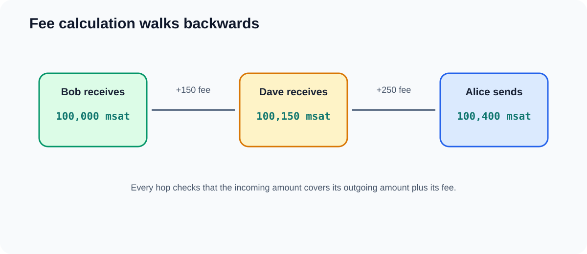

# How Lightning Fees Are Calculated Across Multiple Hops

*A Lightning fee is not one number attached to the whole network. Each forwarding channel contributes its own policy.*

*AI Usage Disclosure: I wrote and researched this article myself. I used AI only to check grammar and language, not for research, structure, or content.*

When Alice pays Bob through Carol and Dave, Alice does not only need to send Bob's amount. She also needs to cover the fees charged by the forwarding nodes.

```text
Alice ──> Carol ──> Dave ──> Bob
```

Bob may request 100,000 msat, while Dave needs to receive more than that and Carol needs to receive more than Dave.

## The basic fee formula

Lightning channel policies commonly describe a base fee and a proportional fee in parts per million:

```text
fee = fee_base_msat + amount_to_forward × fee_proportional_millionths / 1,000,000
```

For example:

```python
def fee(amount_msat, base_msat, ppm):
    return base_msat + amount_msat * ppm // 1_000_000

print(fee(100_000, base_msat=100, ppm=500))
# 150 msat
```

The proportional part is small here: 500 ppm is 0.05%.

The fee policy belongs to a directed channel edge. A channel can have different policies in opposite directions.

## Calculate backwards

The sender calculates the required amounts from the destination backwards.

```text
Bob needs:       100,000 msat
Dave sends:      100,000 msat
Dave's fee:           150 msat
Dave must receive: 100,150 msat
```

If Carol charges 200 msat on the amount Dave needs:

```text
Carol's fee:         250 msat
Alice must send: 100,400 msat
```



The route is encoded with the amount each hop should forward. A forwarding node checks that the incoming amount covers the outgoing amount plus its advertised fee.

The relevant requirements are described in [BOLT 7](https://github.com/lightning/bolts/blob/master/07-routing-gossip.md) and enforced through the onion payload rules in [BOLT 4](https://github.com/lightning/bolts/blob/master/04-onion-routing.md).

## Why the sender pays the fees

The forwarding nodes lock liquidity while an HTLC is pending and take on operational risk. A successful payment lets them claim their fee when the HTLC settles.

```text
Incoming HTLC: 100,400 msat
Outgoing HTLC: 100,000 msat
Fee retained:      400 msat
```

The fee is not normally sent as a separate payment. It appears as the difference between what a node receives and what it forwards.

## Fee limits are separate from channel fees

A sender can set a maximum fee budget. A route may be technically valid but still rejected by the sender's own policy if its total fee is too high.

```python
def acceptable(total_fee_msat, fee_limit_msat):
    return total_fee_msat <= fee_limit_msat

if not acceptable(total_fee_msat=400, fee_limit_msat=300):
    print("try another route")
```

This protects the sender from an unexpectedly expensive route, especially for small payments where a fixed base fee is a large percentage of the amount.

## Why fees can cause a failure

A forwarding node may reject a payment when:

```text
incoming amount - outgoing amount < its required fee
```

A route can fail if:

- the sender calculated using an old channel update;
- a node changed its fee policy;
- the amount was rounded differently than expected;
- the route was constructed for one amount but used for another;
- the sender's fee limit was too low;
- a trampoline node added a fee that was not included in the sender's budget.

Fees and amounts also interact with multi-part payments. Splitting a payment can reduce the liquidity required per channel, but it may introduce more base fees because several HTLCs cross the route.

## A practical comparison

For a 100,000 msat payment:

```text
One hop, 100 msat base fee:       100 msat
Four hops, 100 msat each:         400 msat
Four hops plus proportional fees: more than 400 msat
```

The cheapest path is not always the most reliable path. A slightly more expensive route with better liquidity may succeed while a cheap route fails.

## Final thoughts

Lightning fees are small arithmetic values with large practical consequences. They determine how much the sender locks, whether each forwarding node accepts the HTLC, and whether the sender's own fee budget is respected.

The useful mental model is to start with the receiver's amount and walk backwards. Every hop adds its policy cost. The sender then pays the total required amount at the beginning of the route.

## References & Further Reading

- [BOLT 2 — Peer Protocol](https://github.com/lightning/bolts/blob/master/02-peer-protocol.md)
- [BOLT 4 — Onion Routing Protocol](https://github.com/lightning/bolts/blob/master/04-onion-routing.md)
- [BOLT 7 — P2P Node and Channel Discovery](https://github.com/lightning/bolts/blob/master/07-routing-gossip.md)
