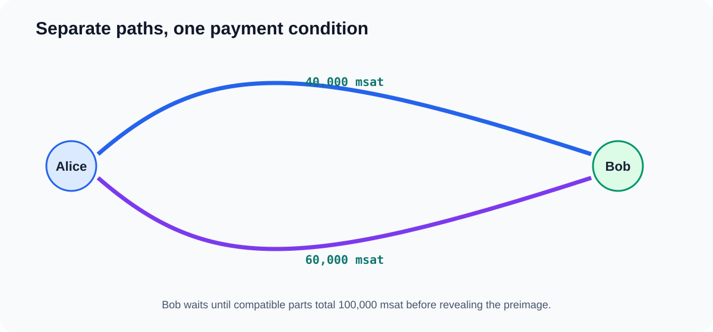

# How Multi-Part Lightning Payments Split and Reassemble

*A large Lightning payment can travel across several paths, but the receiver must still treat it as one conditional payment.*

*AI Usage Disclosure: I wrote and researched this article myself. I used AI only to check grammar and language, not for research, structure, or content.*

Lightning does not require every payment to travel through one route. If no single path can carry the full amount, the sender can split the payment into several HTLCs.

This is called a multi-part payment, or MPP.

## One payment, several HTLCs

Suppose Alice wants to pay Bob 100,000 msat:

```text
             ┌── Carol ── Dave ──┐
Alice ───────┤                    ├── Bob
             └── Erin ─── Frank ──┘
```

Alice might send:

```text
Path 1: 40,000 msat
Path 2: 60,000 msat
Total:  100,000 msat
```

Each part is a separate HTLC, but the parts use the same payment hash. Bob can release one preimage to settle the complete set.



## Why the receiver must wait

If Bob reveals the preimage after receiving only the first 40,000 msat, Alice's upstream nodes may use that preimage to claim their HTLCs. Bob would have accepted only part of the invoice while settling the entire route.

The safe sequence is:

```text
receive parts
validate each part
group compatible parts
wait for the required total
reveal the preimage for the complete set
```

The receiver should not settle individual parts independently when they are intended to form one payment.

## The fields that connect the parts

The payment hash identifies the payment condition. The payment secret identifies the intended invoice. The `total_msat` field tells the receiver what total amount the sender is trying to deliver.

```text
HTLC 1: amt_to_forward = 40,000, total_msat = 100,000
HTLC 2: amt_to_forward = 60,000, total_msat = 100,000
```

The [BOLT 4 specification](https://github.com/lightning/bolts/blob/master/04-onion-routing.md) requires the sender and receiver to handle these values consistently. For an invoice with a specified amount, the total amount must satisfy the invoice while the parts add up to at least that total.

## A simple receiver model

```python
def payment_is_complete(parts, invoice_amount, expected_hash, expected_secret):
    if not parts:
        return False

    if any(part.payment_hash != expected_hash for part in parts):
        return False

    if any(part.payment_secret != expected_secret for part in parts):
        return False

    totals = {part.total_msat for part in parts}
    if len(totals) != 1:
        return False

    total_msat = next(iter(totals))
    received_msat = sum(part.amt_to_forward for part in parts)
    return total_msat >= invoice_amount and received_msat >= total_msat
```

This omits timeout handling, duplicate detection, trampoline nesting, and implementation-specific limits. It illustrates why a receiver needs both a sum and a consistent payment identity.

## Why splitting can help

Channels have directional liquidity. Alice may have 40,000 msat available through Carol and 60,000 msat available through Erin, even though no single path can carry 100,000 msat.

MPP can use both paths:

```text
One route:        capacity available = 60,000 msat
Two routes:       40,000 + 60,000 = 100,000 msat
```

Splitting can improve the chance of finding enough liquidity, but it is not free. More paths mean more fees, more HTLCs, more failure points, and more state for the receiver to track.

## Why a part can arrive late

The parts may travel through different routes. One may arrive quickly while another is delayed by a temporary channel failure or a congested peer.

The receiver keeps the first part pending for a limited time. If the set does not complete, the receiver eventually fails the parts instead of waiting forever.

```text
Part 1 arrives ────────┐
                       ├── enough total? settle
Part 2 arrives later ──┘
                       └── timeout? fail the set
```

This waiting period creates a tradeoff. A short timeout reduces resource usage but may reject slow valid payments. A long timeout holds liquidity and HTLC slots for longer.

## Trampoline payments can add another set

With trampoline routing, the receiver may see an outer set of HTLCs from trampoline paths and an inner set describing the final payment.

```text
Outer set:  amounts delivered to the trampoline boundary
Inner set:  amounts intended for the final recipient
```

The receiver must not merge those sets casually. It should first validate the outer and inner data, then associate only compatible parts with the final invoice.

This is one reason multi-part and trampoline logic needs careful tests. A bug in grouping can make the receiver believe it has received enough even though the parts do not describe one valid payment.

## Final thoughts

MPP is not just “send the same payment twice.” It is a coordinated set of HTLCs that must share identity, amount expectations, and a settlement condition.

The sender gets more routing flexibility. The receiver gets more bookkeeping.

That bookkeeping is part of the security model. Bob should reveal the preimage only after the whole set has passed validation and reached the required amount.

## References & Further Reading

- [BOLT 4 — Onion Routing Protocol](https://github.com/lightning/bolts/blob/master/04-onion-routing.md)
- [BOLT 2 — Peer Protocol](https://github.com/lightning/bolts/blob/master/02-peer-protocol.md)
- [BOLT 11 — Invoice Protocol for Lightning Payments](https://github.com/lightning/bolts/blob/master/11-payment-encoding.md)
