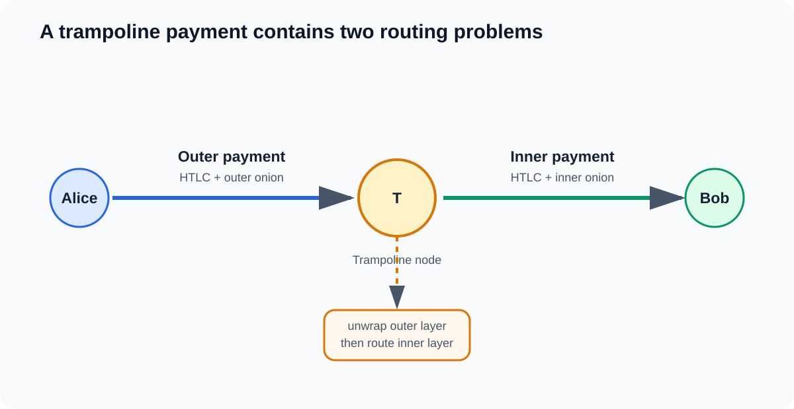
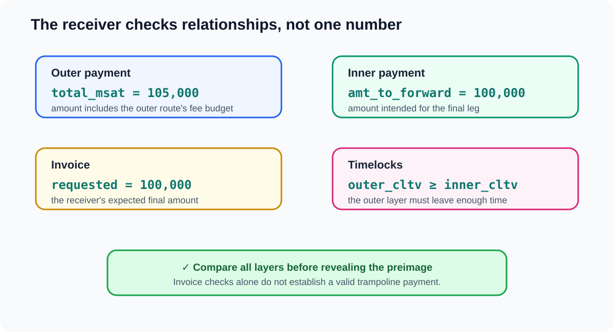
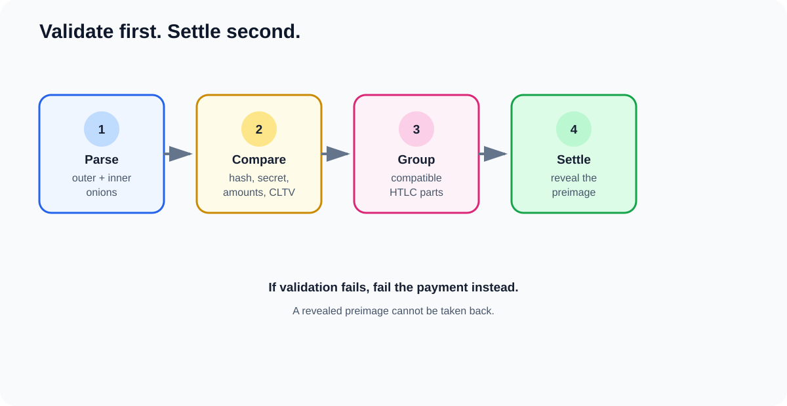

# The Hidden Amount in a Lightning Payment: Why Trampoline Receivers Must Verify More Than the Invoice

*A Lightning invoice tells the receiver what it expects. In a trampoline payment, that is only one part of the story.*

*AI Usage Disclosure: I wrote and researched this article myself. I used AI only to check grammar and language, not for research, structure, or content.*

When a Lightning receiver gets paid, the obvious question is simple:

> Did I receive the amount requested by the invoice?

For an ordinary payment, that question gets you close to the answer. The receiver checks the payment hash, the payment secret, the amount, and the invoice details before releasing the preimage.

Trampoline routing adds another layer.

A trampoline node helps a lightweight wallet route a payment without requiring the wallet to maintain a complete view of the Lightning Network. The sender routes a payment to the trampoline, and the trampoline finds the next part of the route.

That means the receiver may see an outer payment carrying one set of information and an inner trampoline onion carrying another. Both layers have to agree before the receiver should settle anything.

This is not just a matter of neat protocol design. If a receiver checks only the invoice amount, an attacker may be able to construct inconsistent payment data and cause the receiver to reveal a preimage too early.

The important lesson is simple:

> An invoice is an expectation. The onion payload is the payment’s delivery instructions. A safe receiver verifies both.

## Start with an ordinary Lightning payment

Suppose Alice wants to pay Bob 100,000 millisatoshis. Bob creates an invoice containing, among other fields:

```text
payment_hash  = H
payment_secret = S
invoice_amount = 100,000 msat
```

Alice's node builds a route and sends an HTLC to the first forwarding node. Every hop receives an onion payload telling it how much to forward and where to send the next HTLC.

At the final hop, Bob receives information that lets him check:

```text
amount received >= amount requested
payment hash matches the invoice
payment secret matches the invoice
the expiry leaves enough time to settle safely
```

If the payment satisfies the invoice and protocol checks, Bob can reveal the preimage `R` such that:

```text
SHA256(R) = H
```

That preimage travels backwards through the route and settles the HTLCs.

For a normal single-path payment, the amount check is relatively easy to picture. The final HTLC amount and the final onion payload describe the same payment.

## What trampoline routing changes

A mobile wallet may not want to download and maintain the entire channel graph. Instead, it can route the first part of the payment to a trampoline node.

The trampoline node then uses its own view of the network to find a route towards the final receiver.

```text
Alice's wallet        Trampoline              Bob
      │                    │                   │
      │  outer payment     │  inner payment    │
      ├───────────────────>├──────────────────>│
      │                    │                   │
      │  wallet knows      │  trampoline       │
      │  route to T        │  finds route to B  │
```

The first onion tells the trampoline how to handle the outer payment. Inside it is another onion describing the payment’s next leg.

This is why trampoline routing is useful for constrained devices: the sender can delegate part of the path-finding work to another node. It also creates a second boundary where payment amounts and timelocks must be checked.



The trampoline does not simply forward the same HTLC unchanged. It receives an incoming amount, deducts or accounts for its fee, and creates a downstream payment with its own amount and expiry.

The receiver therefore needs to understand which amount belongs to which layer.

## Three amounts that are easy to confuse

Consider a payment intended to deliver 100,000 msat to Bob.

The payment may contain values like these:

```text
Outer HTLC amount:              105,000 msat
Outer onion total_msat:         105,000 msat
Inner onion amt_to_forward:     100,000 msat
Invoice amount:                 100,000 msat
```

The outer amount is larger because it may include fees for the trampoline portion of the route. The inner amount is the amount the next leg is expected to deliver.

These values are related, but they are not interchangeable.

The [Lightning onion-routing specification](https://github.com/lightning/bolts/blob/master/04-onion-routing.md) distinguishes between `amt_to_forward`, which describes the amount for a particular HTLC, and `total_msat`, which describes the total amount expected across a multi-part payment.

That distinction matters even more when trampoline routing and multi-part payments are combined.

## The amount hidden inside the onion

The outer onion may tell the receiver that a trampoline payment carries a total amount of 105,000 msat. The inner onion may say that the downstream payment should forward 100,000 msat to the final receiver.

The receiver should not compare only the incoming HTLC amount with the invoice. It should also check that:

```text
outer total_msat >= outer amount being forwarded
outer total_msat >= inner amt_to_forward
outer expiry >= inner expiry
inner total_msat is consistent across the payment set
inner amt_to_forward satisfies the invoice
```

The exact checks depend on whether the payment is a single HTLC, a basic multi-part payment, or a nested trampoline payment. The general principle does not change: the receiver must validate the relationship between the layers before accepting the payment.



## Why the invoice is not enough

An invoice is usually created before the payment route exists. It can tell Alice that Bob expects 100,000 msat, but it does not describe every fee and forwarding decision made later.

The invoice also does not contain every value that appears in the onion payload. The sender and trampoline nodes add routing information as they construct the payment.

So this check is incomplete:

```python
if received_amount >= invoice_amount:
    settle()
```

It answers only one question: did enough money arrive according to the invoice?

A receiver also needs to ask whether the onion’s internal claims are consistent:

```python
def validate_trampoline_payment(payment, invoice):
    if payment.payment_hash != invoice.payment_hash:
        return False

    if payment.payment_secret != invoice.payment_secret:
        return False

    if payment.inner_amt_to_forward < invoice.amount_msat:
        return False

    if payment.outer_total_msat < payment.outer_amt_to_forward:
        return False

    if payment.outer_total_msat < payment.inner_amt_to_forward:
        return False

    if payment.outer_cltv < payment.inner_cltv:
        return False

    return True
```

This is intentionally simplified. A real implementation also has to handle amountless invoices, multi-part payments, payment timeouts, route blinding, channel-opening fees, and the exact failure rules defined by the implementation and protocol version.

The point is the shape of the validation: the receiver checks the invoice, the outer onion, and the inner onion as one connected set.

## Multi-part payments make the problem more interesting

Lightning can split a payment across several HTLCs. Bob might receive:

```text
HTLC 1: 40,000 msat
HTLC 2: 60,000 msat
Total:  100,000 msat
```

The individual HTLCs may each be smaller than the invoice amount. Bob must group the correct HTLCs together and check their shared payment information.

The [BOLT 4 multi-part payment rules](https://github.com/lightning/bolts/blob/master/04-onion-routing.md) require the payment parts to use consistent total-amount information. The receiver should not release the preimage after receiving an arbitrary partial amount merely because one HTLC contains a convincing invoice reference.

With trampoline payments, the receiver may have two layers of multi-part accounting:

```text
Outer set: parts arriving from the trampoline route
Inner set: parts representing the payment to the final receiver
```

Those sets are not automatically the same. A receiver needs a reliable way to associate the outer parts with the correct inner payment and verify that their totals agree.

This is where seemingly harmless shortcuts become dangerous. Grouping payments only by a payment secret, for example, can mix HTLCs that do not belong to the same final payment. Grouping only by the invoice amount can also miss contradictory `total_msat` values carried in the onion.

## What can go wrong if checks happen too late?

Imagine a receiver performs these steps:

```text
1. Receive HTLC A.
2. See enough money for the invoice.
3. Mark the payment as complete.
4. Reveal the preimage.
5. Validate the remaining onion fields.
```

The order is backwards.

Once the receiver reveals the preimage, an upstream node can use it to claim its incoming HTLC. If another HTLC in the group later turns out to have the wrong payment secret, payment hash, or total amount, the receiver may not be able to undo the preimage release.

The safer order is:

```text
1. Parse every relevant onion.
2. Validate the payment hash and payment secret.
3. Validate outer and inner amounts.
4. Group only compatible HTLCs.
5. Wait for the required total.
6. Reveal the preimage only after the complete set passes validation.
```



This is a general lesson for conditional payments: validation must happen before settlement, not after it.

## A small test matrix

When reviewing a trampoline receiver, I would test at least these cases:

| Case | Outer total | Inner amount | Invoice | Expected result |
|---|---:|---:|---:|---|
| Normal payment | 105,000 | 100,000 | 100,000 | Accept if all other checks pass |
| Underpaid inner payment | 105,000 | 99,000 | 100,000 | Reject |
| Outer total too small | 95,000 | 100,000 | 100,000 | Reject |
| Conflicting inner totals | 105,000 | 100,000 / 90,000 | 100,000 | Reject the set |
| Inner expiry too late | 105,000 | 100,000 | 100,000 | Reject if it violates the outer safety margin |
| Correct amount, wrong secret | 105,000 | 100,000 | 100,000 | Reject |

The useful thing about this table is that it tests relationships, not just individual fields.

## Looking at implementation code

This is the kind of issue that is easy to miss when reading only the invoice-handling code. The invoice check may be correct by itself, while the trampoline comparison happens somewhere else.

For example, an implementation may have one function that validates the final invoice and another function that compares the outer and inner trampoline onions. Both functions can look reasonable in isolation. The security property exists only when both checks happen before the payment is settled.

In Electrum, the trampoline receiver logic explicitly compares values from the outer and inner onions before continuing with the payment set. The project’s security advisory is a useful example of why these checks must also be performed consistently when grouping multi-part payments: [GHSA-8r85-vp7r-hjxf](https://github.com/spesmilo/electrum/security/advisories/GHSA-8r85-vp7r-hjxf).

The relevant implementation questions are:

```text
Where is the outer onion parsed?
Where is the inner trampoline onion parsed?
What key groups the received HTLCs?
When are total_msat values compared?
When is the invoice payment marked complete?
When is the preimage released?
```

Following those questions through the code is often more useful than searching for one function named `check_amount`.

## The receiver's rule of thumb

For an ordinary single-path payment, the invoice amount is a good starting point. For a trampoline payment, it is not the complete payment description.

The receiver should verify:

```text
invoice identity
payment hash
payment secret
outer HTLC amount
outer total_msat
inner amt_to_forward
inner total_msat
CLTV relationships
multi-part grouping
```

Only after those values describe one coherent payment should the receiver reveal the preimage.

That may sound like a lot of checking for one payment. But the receiver is not just checking whether someone sent enough money. It is checking whether the sender has constructed a valid chain of conditional obligations that can be settled safely across multiple layers.

## Final thoughts

Trampoline routing moves part of the routing problem away from the sender. That is valuable for mobile and lightweight wallets, but it also means payment information is nested.

The invoice describes what the receiver expects. The outer onion describes the payment arriving at the trampoline boundary. The inner onion describes the payment that should continue toward the receiver.

Those descriptions must agree.

The dangerous assumption is that the largest visible amount, or the invoice amount alone, tells the whole story. In a layered payment, the receiver has to verify the relationships between amounts before releasing the one thing that makes the HTLCs spendable: the preimage.

That is the hidden amount problem. It is not really about one field. It is about making sure every layer is describing the same payment.

## References & Further Reading

- [BOLT 2 — Peer Protocol](https://github.com/lightning/bolts/blob/master/02-peer-protocol.md): HTLC forwarding and timeout requirements.
- [BOLT 3 — Transactions](https://github.com/lightning/bolts/blob/master/03-transactions.md): HTLC-success and HTLC-timeout transaction paths.
- [BOLT 4 — Onion Routing Protocol](https://github.com/lightning/bolts/blob/master/04-onion-routing.md): onion payloads, `amt_to_forward`, `total_msat`, and multi-part payments.
- [BOLT 7 — P2P Node and Channel Discovery](https://github.com/lightning/bolts/blob/master/07-routing-gossip.md): routing fees and CLTV deltas.
- [Electrum security advisory GHSA-8r85-vp7r-hjxf](https://github.com/spesmilo/electrum/security/advisories/GHSA-8r85-vp7r-hjxf): an example of why trampoline receiver validation and payment grouping matter.
- [LDK onion payload implementation](https://docs.rs/lightning/latest/src/lightning/ln/onion_utils.rs.html): a current implementation showing trampoline payload construction.
