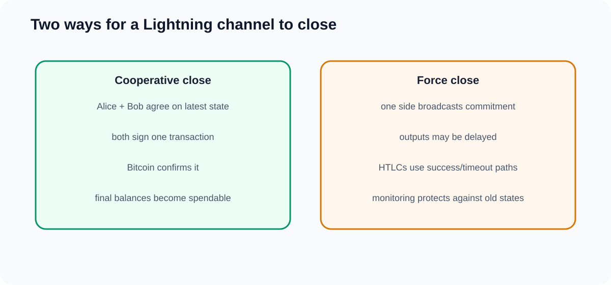

# What Actually Happens When a Lightning Channel Closes

*Closing a Lightning channel is not one event. The result depends on whether both sides cooperate.*

*AI Usage Disclosure: I wrote and researched this article myself. I used AI only to check grammar and language, not for research, structure, or content.*

A Lightning channel is an off-chain agreement backed by an on-chain funding output. While the channel is open, both participants update their balances without publishing every payment to Bitcoin.

Eventually, the channel may close. What happens next depends on the type of close.

## Cooperative close

In a cooperative close, both sides agree on the latest channel state and sign a closing transaction.

```text
Alice and Bob agree on the final balance
             ↓
Both sign one closing transaction
             ↓
Bitcoin confirms the transaction
             ↓
Each side receives its final output
```

This is usually the simplest path. It can avoid many of the delay mechanisms used for unilateral closes.



## Force close

If Bob disappears or refuses to cooperate, Alice can broadcast her latest commitment transaction. This is a unilateral or force close.

The commitment transaction contains outputs representing the current channel state. Some outputs may be immediately spendable. Others are protected by timelocks or require special handling.

The important word is **latest**. Lightning participants exchange revocation information whenever they update the channel. An old commitment transaction should be dangerous to broadcast.

## Why old states are unsafe

Imagine the channel moved through these states:

```text
State 1: Alice 0.7 BTC, Bob 0.3 BTC
State 2: Alice 0.5 BTC, Bob 0.5 BTC
```

If Alice broadcasts State 1 after both sides have moved to State 2, she is trying to claim more than the current agreement allows.

The revocation mechanism gives Bob a way to punish that behavior, subject to the channel's scripts and the time available to react. This is why a user who operates a Lightning node must either monitor the chain or use a watchtower-like service.

The [BOLT 3 transaction specification](https://github.com/lightning/bolts/blob/master/03-transactions.md) describes commitment outputs, revocation paths, and the delayed spending rules.

## The delay is part of the security model

After a force close, one party may not be able to spend its balance immediately. A `to_self_delay` gives the other party time to detect and punish a revoked state.

```text
Commitment transaction confirmed
             ↓
Delayed output cannot be spent yet
             ↓
Counterparty can react to a revoked state
             ↓
Delay expires and the honest party can claim
```

The delay is inconvenient, but it changes the incentive to cheat. Publishing an old state becomes risky instead of profitable.

## HTLC outputs during a close

A channel can close while payments are still in flight. Those HTLCs need their own resolution paths.

An HTLC output generally has two important possibilities:

```text
Preimage path:  claim with the payment preimage
Timeout path:   reclaim after the CLTV expiry
```

If the receiver reveals the preimage, the payment can be settled. If the payment does not complete, the timeout path eventually allows the appropriate party to recover the funds.

The exact transaction structure varies with the channel options, but the principle remains: a commitment transaction must preserve a safe way to resolve every pending HTLC.

## A simple state model

The following pseudocode is not a wallet implementation, but it shows the decisions a channel manager has to make:

```python
def resolve_htlc(htlc, current_height, preimage=None):
    if preimage is not None and sha256(preimage) == htlc.payment_hash:
        return "claim with HTLC-success path"

    if current_height >= htlc.cltv_expiry:
        return "recover with HTLC-timeout path"

    return "keep watching"
```

Real implementations must also account for commitment numbers, revocation secrets, transaction confirmation, fee policy, and reorg safety.

## Why backups matter

A channel is not only a funding output. The participants need the latest channel state and the information required to close safely.

If a node loses its database, a static channel backup may allow it to contact the peer and recover the channel through a cooperative or force-close process. It is not the same as restoring every historical state, and it does not remove the need for careful operational procedures.

## Final thoughts

An open channel feels like a balance in a wallet, but technically it is a live state machine secured by Bitcoin transactions and timelocks.

Cooperative close is the clean exit. Force close is the recovery path when cooperation is unavailable. Revocation and delay rules make old states unsafe, while HTLC timeout and success paths resolve payments that were still moving when the channel closed.

Understanding those paths makes channel backups, monitoring, and watchtowers feel less like optional features and more like parts of the channel's security model.

## References & Further Reading

- [BOLT 2 — Peer Protocol](https://github.com/lightning/bolts/blob/master/02-peer-protocol.md)
- [BOLT 3 — Bitcoin Transaction and Script Formats](https://github.com/lightning/bolts/blob/master/03-transactions.md)
- [BOLT 5 — Recommendations for On-chain Transaction Handling](https://github.com/lightning/bolts/blob/master/05-onchain.md)
