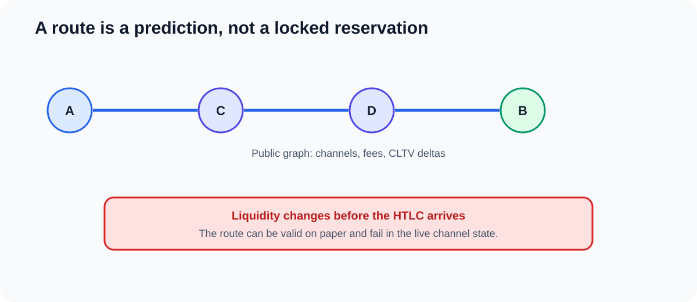

# Why Lightning Payments Fail Even When the Route Looks Good

*A route can look valid on paper and still fail when the payment actually meets the channels.*

*AI Usage Disclosure: I wrote and researched this article myself. I used AI only to check grammar and language, not for research, structure, or content.*

One of the first confusing things about Lightning is seeing a payment fail even though the wallet found a route.

The route may contain the right nodes. The channels may be publicly announced. The fees may fit the sender's limit. Yet the payment still returns an error.

That is not necessarily a contradiction. A Lightning route is a plan made from information that is incomplete, delayed, and partly private.

## A route is not a reservation

Suppose Alice's wallet finds this route:

```text
Alice ──> Carol ──> Dave ──> Bob
```

The wallet can see that these channels exist and can calculate the advertised fees and CLTV deltas. But it cannot see the exact balance available in each direction.

```text
Public information:       channel exists, fee policy, CLTV delta
Private information:      current directional liquidity
```

Alice may find a route that appears capable of carrying 200,000 msat. Before the HTLC reaches Carol, another payment may consume the available outbound liquidity. The route was not necessarily bad when it was calculated. It simply stopped being usable.



## The amount changes at every hop

Forwarding nodes charge fees. If Bob should receive 100,000 msat, Dave needs to receive slightly more, and Carol needs to receive more than Dave.

For a proportional fee, a simplified calculation looks like this:

```python
def forwarding_fee(amount_msat, base_msat, ppm):
    return base_msat + (amount_msat * ppm // 1_000_000)

amount_to_bob = 100_000
fee_dave = forwarding_fee(amount_to_bob, base_msat=100, ppm=500)
amount_to_dave = amount_to_bob + fee_dave

print(fee_dave, amount_to_dave)
```

The sender builds the route backwards from the receiver so it can calculate the required amount and expiry at each hop. If a forwarding node receives less than the amount it was promised to forward, it rejects the HTLC.

The official [BOLT 7 routing specification](https://github.com/lightning/bolts/blob/master/07-routing-gossip.md) describes the fee formula and the role of `cltv_expiry_delta`.

## CLTV can make a route unsafe

Every hop also needs enough time to settle its outgoing HTLC before its incoming HTLC expires. The upstream expiry must be later than the downstream expiry.

```text
Alice -> Carol: expiry 720
Carol -> Dave:  expiry 700
Dave -> Bob:    expiry 680
```

If the differences are too small, a node may not have enough time to learn the preimage, go on-chain, and claim its incoming HTLC. A node can reject the payment even when the amounts are correct.

This is why a route carries more than a list of node IDs. It carries amounts, fees, channel references, and expiry values.

## Failure messages are useful clues

Lightning failures are deliberately onion-wrapped. The sender may learn that a particular part of the route failed, but it should not automatically learn every detail about the network.

Common causes include:

```text
temporary_channel_failure  -> the channel could not forward now
fee_insufficient            -> the amount did not cover the advertised fee
incorrect_cltv_expiry       -> the expiry relationship was invalid
unknown_next_peer           -> the next hop was unavailable or incorrect
temporary_node_failure      -> retrying through another path may work
```

The sender's wallet can use these results to try a different route. It should not treat one failed attempt as proof that the destination is unreachable.

## A small debugging checklist

When reviewing a failed payment, ask:

```text
1. Was the final amount correct?
2. Did every hop receive enough to pay its next hop and fee?
3. Were the CLTV deltas large enough?
4. Could liquidity have changed after route construction?
5. Was the failure temporary or permanent?
6. Did a retry use a genuinely different route?
```

The last question matters. Retrying the same path immediately may only reproduce the same failure.

## Final thoughts

Lightning routing is closer to making a best-effort delivery plan than booking a guaranteed railway seat. The network reveals enough information to calculate a route, but not enough to reserve every channel balance in advance.

That tradeoff helps preserve privacy and keeps routing decentralized. It also explains why successful payment systems need retries, route diversification, fee limits, and careful failure handling.

The route looked good because it was a reasonable prediction. The payment failed because the network is a live system.

## References & Further Reading

- [BOLT 2 — Peer Protocol](https://github.com/lightning/bolts/blob/master/02-peer-protocol.md)
- [BOLT 4 — Onion Routing Protocol](https://github.com/lightning/bolts/blob/master/04-onion-routing.md)
- [BOLT 7 — P2P Node and Channel Discovery](https://github.com/lightning/bolts/blob/master/07-routing-gossip.md)
