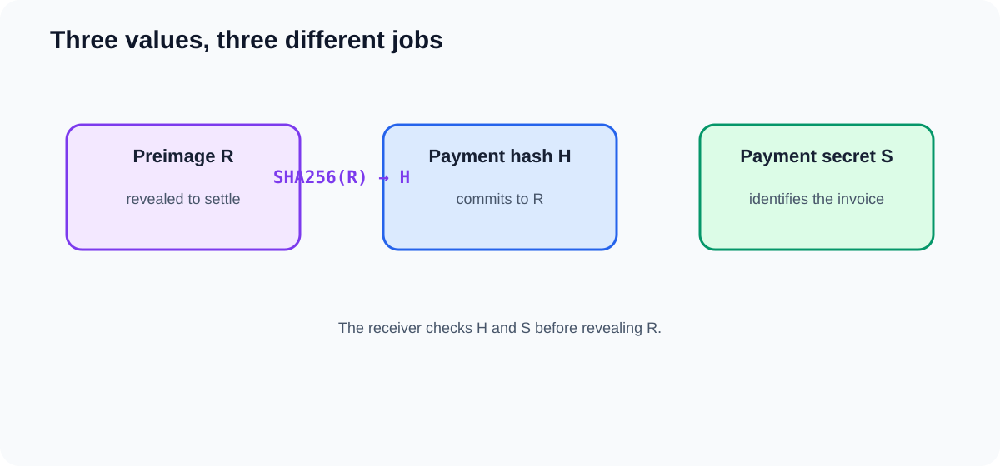

# Why Payment Secrets Matter in Lightning Invoices

*The payment hash identifies the condition. The payment secret helps prove that the payment belongs to the intended receiver.*

*AI Usage Disclosure: I wrote and researched this article myself. I used AI only to check grammar and language, not for research, structure, or content.*

A Lightning invoice contains more than an amount and a destination. Modern invoices also include a payment secret, and the receiving node expects that secret to appear in the final onion payload.

At first, this can look redundant. The invoice already has a payment hash. Why add another secret?

The answer is that the two values do different jobs.

## Hash and secret are not the same thing

The payment hash is linked to the preimage:

```text
preimage R  ──SHA256──>  payment_hash H
```

The receiver eventually reveals `R` to settle the HTLC. The payment secret `S` is separate. It is generated by the receiver and included in the invoice so the final node can recognize a payment intended for that invoice.

```text
Invoice:
  payment_hash   = H
  payment_secret = S
```

The [BOLT 11 invoice specification](https://github.com/lightning/bolts/blob/master/11-payment-encoding.md) and [BOLT 4 onion specification](https://github.com/lightning/bolts/blob/master/04-onion-routing.md) define how these values are carried and checked.

## What the secret helps prevent

Without a payment secret, a node could be more vulnerable to probing attempts. An attacker might send HTLCs that look like payments and observe how the receiver responds.

The secret gives the receiver another condition to check before accepting the payment as its own.

```python
def belongs_to_invoice(onion, invoice):
    return (
        onion.payment_secret == invoice.payment_secret
        and onion.payment_hash == invoice.payment_hash
    )
```

This is simplified, but the important idea is that a valid amount is not enough. The payment also needs the right identity information.



## The secret is not the preimage

These three values should not be mixed up:

```text
Payment secret:  identifies the intended invoice
Payment hash:    commits to the payment preimage
Preimage:        proves the HTLC success condition
```

The receiver knows the payment secret before the payment arrives. The receiver keeps the preimage private until the payment passes validation.

That order matters. Revealing the preimage is what allows upstream nodes to settle their incoming HTLCs.

## Multi-part payments use the same secret

Suppose Alice splits a 100,000 msat payment into two parts:

```text
Part 1: 40,000 msat
Part 2: 60,000 msat
```

The parts use the same payment hash and payment secret so Bob can group them as one payment. Bob should wait until the compatible set reaches the required total before revealing the preimage.

The [multi-part payment rules in BOLT 4](https://github.com/lightning/bolts/blob/master/04-onion-routing.md) describe the relationship between `amt_to_forward`, `total_msat`, payment hashes, and payment secrets.

```python
def can_settle(parts, invoice):
    if any(part.payment_secret != invoice.payment_secret for part in parts):
        return False
    if any(part.payment_hash != invoice.payment_hash for part in parts):
        return False
    return sum(part.amt_to_forward for part in parts) >= invoice.amount_msat
```

Real implementations also check that the total amount fields are consistent and that the HTLC set has not expired.

## Grouping is a security decision

A receiver needs a key for grouping incoming HTLCs. For a simple payment, the payment hash may appear sufficient. Trampoline payments complicate this because the outer and inner payments can use different stages of the route and may need separate grouping before being combined.

Grouping only by a convenient field can create dangerous mixtures:

```text
HTLC A: correct invoice secret, payment hash A
HTLC B: same visible grouping field, payment hash B
```

If the receiver counts both parts toward one payment and reveals a preimage too early, an attacker may benefit from the mismatch.

The receiver must validate the complete identity of every part before treating it as part of a payment set.

## What a receiver should check

Before settlement, the receiver should verify at least:

```text
payment hash matches the invoice
payment secret matches the invoice
total amount fields are consistent
the HTLC parts belong to the same payment set
the received amount satisfies the invoice
the CLTV expiry is safe
the invoice has not already been paid or expired
```

The exact checks vary with the payment type, but skipping identity validation because the amount looks correct is unsafe.

## Final thoughts

The payment hash and payment secret may both look like random 32-byte values, but they answer different questions.

The hash answers: “What preimage can settle this payment?”

The secret answers: “Was this payment intended for my invoice?”

A receiver needs both answers before revealing the preimage. That small distinction becomes especially important when multi-part and trampoline payments introduce more than one layer of payment data.

## References & Further Reading

- [BOLT 4 — Onion Routing Protocol](https://github.com/lightning/bolts/blob/master/04-onion-routing.md)
- [BOLT 11 — Invoice Protocol for Lightning Payments](https://github.com/lightning/bolts/blob/master/11-payment-encoding.md)
- [BOLT 2 — Peer Protocol](https://github.com/lightning/bolts/blob/master/02-peer-protocol.md)
